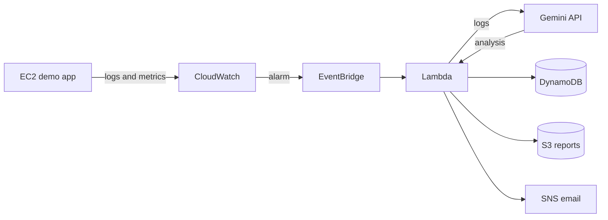

# Architecture

## Flow

## Services

| Service | Role |
|---|---|
| EC2 + VPC + Security Group | Runs the demo app in a private network |
| CloudWatch | Logs, metrics, alarms, dashboard |
| EventBridge | Connects the alarm to Lambda |
| Lambda | Collects data and calls Gemini |
| DynamoDB + S3 | Incident history and full reports |
| SNS | Email alerts |
| IAM + SSM | Least-privilege roles, safe API key storage |

## Security (draft)

- Each Lambda has its own IAM role with only the permissions it needs.
- The Gemini API key is stored in SSM Parameter Store, never in Git.
- S3 buckets are private.

## TODO

- Data flow diagram
- Sequence diagram
- Cost analysis
